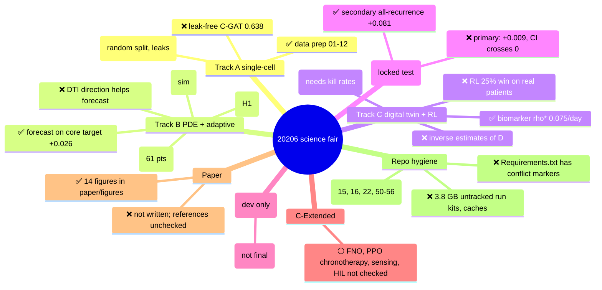

# Repo Mind Map: 20206 science fair (detailed)

Made 2026-10-14. Read-only map. No code or data was changed.

## How to read this

- ✅ **Positive**: the code runs, or the result supports the idea. Often simulation only, or dev data only. The note says which.
- ❌ **Negative**: the code is broken, the result does not support the idea, or there is a known problem.
- ⚪ **Neutral / not checked**: a plain file, or I did not read a result for it.
- "Output paths in code: found / total" = how many output file names written in the script exist on disk. A "0 / N" can mean the name is built at run time (for example with `{pid}`), so it is not a sure sign of failure.
- Numbers come from files. Each one names its source file.

## Weakest points of this map

1. Status is from vault notes and a few JSON files. I did not re-run any script.
2. 196 script rows: purpose text is each file's first docstring line. Scripts with no docstring show the name only.
3. Pytest was not run. CLAUDE.md says 56 tests. Grep finds 101 `def test_` functions. One of them is out of date.

---

## 1. Quick mind map

---

## 2. Root folder (`/`)

### 2a. Documents and config

| Item | Kind | What it is | Status |
|---|---|---|:---:|
| `README.md` | doc | Public README. Says "Month 10 complete". Vault says it has stale claims. | ❌ stale |
| `CLAUDE.md` | doc | Instructions for Claude Code | ⚪ |
| `LICENSE` | doc | MIT license (per README badge) | ⚪ |
| `analysis_plan_v1.md` | doc | First analysis plan. Source of "A1.x" labels in scripts. | ⚪ |
| `most_revolutionary_track.md` | doc | Note on which track is strongest | ⚪ |
| `discrepancies_table.md` | doc | List of mismatches between claims and files | ⚪ |
| `FIXES_SUMMARY.md` | doc | Log of fixes | ⚪ |
| `TRACK_A_RESULTS.md` | doc | Track A results (older copy; vault has the main one) | ⚪ |
| `emails_to_professors.md` | doc | Draft email to professors | ❌ duplicate |
| `emails_to_professors_final.md` | doc | Final draft email | ⚪ |
| `Requirements.txt` | config | Python packages list | ❌ has unresolved merge conflict markers. Use `pyproject.toml`. |
| `requirements-docker.txt` | config | Packages for Docker | ⚪ |
| `pyproject.toml` | config | Project metadata and dependencies (use this one) | ⚪ |
| `Makefile` | config | Targets: `build`, `build-sha`, `run`, `test`, `shell`, `multiomic`, `uq`, `clean`, `prune` | ⚪ not run |
| `Dockerfile` | config | Container build | ⚪ not run |
| `docker-compose.yml` | config | Container services | ⚪ |
| `docker-entrypoint.sh` | script | Container start script | ⚪ |
| `run_all.sh` | script | Track B chain: 42 → 48 → 45 (bash) | ⚪ |
| `run_all.ps1` | script | Same chain for PowerShell | ⚪ |
| `run_pde_manifest.ps1` | script | Runs the PDE manifest job on Windows | ⚪ |
| `.gitignore` | config | Git ignore rules | ⚪ |

### 2b. Logs and stray files at root

| Item | What it is | Status |
|---|---|:---:|
| `run1.log` | Old run log | ❌ clutter |
| `run_hash_0.log` | Old run log | ❌ clutter |
| `terminal_session.txt` | Saved terminal text | ❌ clutter |
| `tensor_UCSF-PDGM-0004_50.npy` | One saved tensor for one patient | ❌ data in code folder |
| `track_a_metrics.zip` | Zipped Track A metrics | ⚪ |
| `outputs/` (folder, see §10g) | Second output folder, one PNG | ❌ two output folders |

### 2c. Loose Python files at root (not in `src/`)

These are older or one-off helpers. They sit beside the pipeline. Many are debug checks.

| File | Purpose (from name / first line) | Status |
|---|---|:---:|
| `run_improved_aniso.py` (49 KB) | Forecast test, anisotropic (DTI) vs isotropic growth models, on real follow-up MRI. Main validation study. | ⚪ result not read here. Ledger says DTI does not help. |
| `cross_validation.py` (4 KB) | Cross-validation for the validation study | ⚪ |
| `isef_figures.py` (7 KB) | Figures for the science fair | ⚪ |
| `run_digital_twin.py` (4 KB) | Single entry point for real-patient digital twin workflow | ⚪ |
| `run_dki_only.py` (7 KB) | Run only the DKI variant | ⚪ |
| `run_growth_and_treatment.py` | Growth plus treatment run | ⚪ |
| `run_local.py` | Local run wrapper | ⚪ |
| `five_patient_validation.py` | 5-patient anisotropic vs isotropic check | ⚪ |
| `method3_tensor_recon.py` | Full DTI tensor from raw 4D DWI | ⚪ |
| `optionC_grade23.py` | Grade 2/3 glioma patients, anisotropic | ⚪ |
| `patient_0004_3d.py` | Full 3D check for patient 0004 | ⚪ |
| `patient_0004_real_test.py` | Real end-to-end test, patient 0004 | ⚪ |
| `patient_0004_test.py` | Test, patient 0004 | ⚪ |
| `single_patient_l1test.py` | One patient, L1-gradient tensor vs isotropic | ⚪ |
| `fetch_longitudinal.py` | Fetch follow-up scans | ⚪ |
| `calibrate_rho.py` | Calibrate growth rate rho from MU-Glioma-Post volumes | ⚪ |
| `add_location.py` | Adds tumour location to cohort | ⚪ |
| `add_low_grade.py` | Adds grade 2-3 patients to cohort | ⚪ |
| `summary.py` | Summary printout | ⚪ |
| `visualize_3d.py` | 3D view | ⚪ |
| `debug_dki.py`, `debug_eigenvalues.py` | Debug helpers | ❌ debug |
| `check_4d.py`, `check_all_shapes.py`, `check_cohort.py`, `check_events.py`, `check_fk.py`, `check_html.py`, `check_html2.py`, `check_outliers.py`, `check_overlap.py`, `check_results.py`, `check_rho.py`, `check_ti.py`, `check_ti2.py` | Quick checks (13 files) | ❌ clutter, no docstrings |
| `test_all_shapes.py`, `test_debug.py`, `test_dki_batch.py`, `test_kappa.py`, `test_pd_fix.py`, `test_seg_shape.py`, `test_shapes.py`, `test_strang.py`, `test_strang_final.py`, `test_wave_speed.py` | Loose test scripts (10 files). Not in `tests/`, so pytest does not collect them. | ❌ clutter |

---

## 3. `src/` (192 files, the code)

Every `.py` file in `src/`, one row each. Purpose = the file's own first docstring line. Status is from the vault notes and result files named in the row. Script numbers 01–99 are the main pipeline. Numbers 100–126 are newer (PREDICT-GBM and UCSF H-2/H-3 work).

The table below lists the `src/` files. Support modules are in §4b. Subfolders (`hil`, `neural_pde`, `rl`, `sensing`) are in §4.

| File | KB | What it does (from its own first line) | Output paths in code: found / total | Status | Note |
|---|---:|---|---:|:---:|---|
| `01_load_and_filter.py` | 5 | 01_load_and_filter.py | 0 / 0 | ✅ | data prep ran; 140,355 cells |
| `02_preprocess_umap_de.py` | 10 | 02_preprocess_umap_de.py | 0 / 0 | ✅ | UMAP and DE ran |
| `03_finalize_de_and_export_for_nn.py` | 3 | 03_finalize_de_and_export_for_nn.py | 0 / 0 | ✅ | DE export ran |
| `04_export_for_attention_model.py` | 4 | 04_export_for_attention_model.py | 0 / 0 | ✅ | NN tensors written |
| `05_attention_gated_network.py` | 11 | 05_attention_gated_network.py | 0 / 0 | ✅ | attention NN 78.4% test acc |
| `06_method1_classical_baseline.py` | 6 | 06_method1_classical_baseline.py | 0 / 0 | ✅ | LR 0.698 / RF 0.726 baselines |
| `07_method2_transformer.py` | 9 | 07_method2_transformer.py | 0 / 0 | ❌ | transformer 0.496, weak |
| `08_method3_hybrid.py` | 12 | 08_method3_hybrid.py | 0 / 0 | ❌ | hybrid 0.512, weak |
| `09_benchmark_comparison.py` | 6 | 09_benchmark_comparison.py | 0 / 0 | ✅ | benchmark table written |
| `100_pde_manifest.py` | 22 | Script 100: PDE forecasts on the manifest pairs and split, extended grid, clamp log (Phase 2.3; plan A1.1, A1.5). | 0 / 0 | ❌ | H1 PDE vs persistence: GBM-only +0.013, CI crosses 0 |
| `101_dti_alignment.py` | 7 | Script 101: why does DTI not help? Direction-alignment test (Phase 2.4; masterplan §86-88; plan A1.9, exploratory). | 0 / 0 | ⚪ |  |
| `102_subgroups.py` | 8 | Script 102: subgroup, catastrophic-error and residual analysis of the baseline ladder (Phase 3.2, 3.6; plan A1.13-A1.15). | 0 / 0 | ⚪ |  |
| `103_segmentation_perturbation.py` | 7 | Script 103: how much of the forecast effect is within segmentation / registration noise? (Phase 3.3; plan A1.x, review round 2 item 7) | 0 / 0 | ⚪ |  |
| `104_measured_noise_floor.py` | 11 | Script 104: measured segmentation noise floor (Amendment 6 A6.5; GRAND_PLAN #12, #18; weak points W16, W24). | 0 / 0 | ✅ | measured noise floor: 0.88 vs 1.02 assumed |
| `105_shape_skill_matched.py` | 9 | Script 105: volume-matched shape test (Amendment 6 A6.4; GRAND_PLAN #2). Exploratory. | 0 / 0 | ❌ | volume-matched shape gain -0.0002 (none) |
| `106_boundary_noise_measured.py` | 9 | Script 106: measured boundary disagreement between two segmenters (removes the ASSUMED 2 mm in script 103). Exploratory. | 0 / 0 | ⚪ |  |
| `107_front_speed_correction.py` | 5 | Script 107: grid front-speed correction at h = 2 mm (GRAND_PLAN L2b; weak point W22). Numerics only, no patient data. | 0 / 0 | ⚪ |  |
| `108_pack_masks_for_kaggle.py` | 4 | Script 108: build the private Kaggle dataset for the GPU forecast runs (GRAND_PLAN L3, L2a). | 2 / 2 | ⚪ |  |
| `109_upenn_rater_noise.py` | 9 | Script 109: expert-correction noise on UPENN-GBM (GRAND_PLAN L5/L6 substitute). Exploratory, declared before the run. | 0 / 0 | ⚪ |  |
| `10_cvae_pretrain.py` | 10 | 10_cvae_pretrain.py | 0 / 0 | ✅ | cVAE trained (32-dim) |
| `110_forecast_viewer_3d.py` | 9 | Script 110: 3D tumour-forecast viewer, research prototype of a clinical tool (GRAND_PLAN section 11; Amendment 7 A7.5). | 0 / 0 | ⚪ |  |
| `111_predictgbm_reproduce_dev.py` | 4 | Script 111: reproduce the PREDICT-GBM evaluation on DEVELOPMENT patients only (TUM; Amendment 6 A6.6, A7.6). | 0 / 0 | ⚪ |  |
| `112_predictgbm_models_dev.py` | 8 | Script 112: H-2 growth models M1 / M2 on PREDICT-GBM development patients (Amendment 6 A6.6, Amendment 7 A7.1). | 0 / 0 | ⚪ |  |
| `113_pack_predictgbm_for_kaggle.py` | 3 | Script 113: private Kaggle pack of PREDICT-GBM inputs for the GPU runs of script 112 (MIT-licensed public data). | 1 / 1 | ⚪ |  |
| `114_predictgbm_m3_patient_fit.py` | 6 | Script 114: H-2 model M3, per-patient fit from the pre-op scan only (Amendment 7 A7.2, thresholds A7.2a). | 0 / 0 | ⚪ |  |
| `115_predictgbm_unet_dev.py` | 14 | Script 115: H-2 learned arm (GRAND_PLAN 12 B2) and hybrid arm (B3): small 3D U-Net on PREDICT-GBM development patients. | 0 / 0 | ✅ | INTERIM dev arm +0.027 (dev only) |
| `116_pack_predictgbm_mri.py` | 2 | Script 116: pack pre-op MRI (T1c, FLAIR; already brain-extracted and scaled 0-1 by PREDICT-GBM) at 2 mm for the | 0 / 0 | ⚪ |  |
| `117_predictgbm_volume_curves.py` | 7 | Script 117: GRAND_PLAN 13 X1 (barrier-aware geodesic plan) and X2 (coverage-volume curves), PREDICT-GBM development. | 0 / 0 | ⚪ |  |
| `118_cgga_adjusted_age_mgmt.py` | 3 | Script 118: GRAND_PLAN 14 Y5 (age adjusted for IDH and treatment) and Y2 (MGMT within TMZ-treated), CGGA GBM. | 0 / 0 | ✅ | age adjusted (ledger 2ar); MGMT not shown |
| `119_mu_fitted_treatment_response.py` | 7 | Script 119: GRAND_PLAN 14 Y1, per-patient treatment response fitted on the previous pair (MU, exploratory). | 0 / 0 | ⚪ |  |
| `11_cvae_extract_latent.py` | 5 | 11_cvae_extract_latent.py | 0 / 0 | ✅ | latents for 140,355 cells |
| `120_predictgbm_ensembles.py` | 4 | Script 120: GRAND_PLAN 15 Z1 (= 13 X3) ensembles, PREDICT-GBM development (TUM). | 0 / 0 | ⚪ |  |
| `121_pack_mu_training.py` | 4 | Script 121: pack MU-Glioma-Post pairs as extra U-Net TRAINING samples (GRAND_PLAN 15 Z2, declared before the run). | 0 / 0 | ⚪ |  |
| `122_predictgbm_final_train_predict.py` | 3 | Script 122: H-2 FINAL model (frozen in configs/h2_frozen.yaml): train once, predict the locked test patients. | 0 / 0 | ✅ | final model trained, 84 min; test not read by script |
| `123_predictgbm_test_score.py` | 4 | Script 123: H-2 locked TEST evaluation, run ONCE after the freeze (configs/h2_frozen.yaml + git tag h2-frozen). | 0 / 0 | ❌ | H-2 locked test: primary CI crosses 0, fails own rule |
| `124_pack_ucsf_h3_inputs.py` | 6 | Script 124: H-3 test INPUTS from UCSF-PDGM pre-op scans, aligned to UCSF-ALPTDG time1 space (Amendment 9). | 0 / 0 | ✅ | 59 UCSF pts packed for H-3 |
| `125_published_unet_inference.py` | 6 | Script 125: run the released PREDICT-GBM U-Net (rebuild in unet_published.py) leak-free (Amendment 9, A9.5). | 0 / 0 | ✅ | released U-Net rebuilt; validation json exists |
| `126_h3_dev_ensembles.py` | 4 | Script 126: H-3 development scoring of candidates C2 / C4 / C5 (Amendment 9, A9.3 and A9.5). | 0 / 0 | ✅ | INTERIM dev C1 +0.030 (CI 0.005–0.060) |
| `12_gat_build_graph.py` | 4 | 12_gat_build_graph.py | 0 / 0 | ✅ | kNN graph 15k nodes |
| `13_gat_train.py` | 9 | 13_gat_train.py | 0 / 0 | ❌ | 0.787 acc on RANDOM split: leak-prone, unreliable |
| `14_cgat_evaluate.py` | 6 | 14_cgat_evaluate.py | 0 / 0 | ❌ | skipped; numbers typed by hand |
| `15_baseline_scvi.py` | 9 | (no docstring) name says: 15 baseline scvi | 4 / 4 | ✅ | scVI baseline 0.730 acc |
| `15_cgat_build_graph.py` | 4 | 15_cgat_build_graph.py | 0 / 0 | ⚪ | not checked (matched by number only) |
| `16_baseline_nmf.py` | 3 | (no docstring) name says: 16 baseline nmf | 4 / 6 | ✅ | NMF baseline 0.610 acc |
| `16_cgat_train.py` | 8 | 16_cgat_train.py | 0 / 0 | ⚪ | not checked (matched by number only) |
| `17_gradient_diagnostic.py` | 3 | (no docstring) name says: 17 gradient diagnostic | 4 / 5 | ⚪ |  |
| `18_csgt_framework.py` | 6 | (no docstring) name says: 18 csgt framework | 6 / 9 | ⚪ |  |
| `19_phenotypic_velocity.py` | 12 | Month 1: Biophysical Velocity Fields & Waddington Landscape Physics | 7 / 10 | ⚪ |  |
| `20_fokker_planck_solver.py` | 11 | Month 1, Week 2: Fokker-Planck Energy Landscape Reconstruction — CALIBRATED | 9 / 12 | ⚪ |  |
| `21_drift_diffusion_analysis.py` | 6 | Month 1 Week 3: Drift & Diffusion Tensor Analysis | 8 / 12 | ⚪ |  |
| `22_saddle_point_proof.py` | 13 | 22_saddle_point_proof.py (v3 — zone-aware) | 6 / 7 | ⚪ | zone-aware saddle check v3; result not read |
| `22_saddle_point_proof_backup.py` | 21 | Month 1, Week 4: Saddle Point Proof — Climbing Image NEB (CI-NEB) Solver | 5 / 5 | ⚪ | old backup copy (CI-NEB) |
| `22_spib_saddle_proof.py` | 10 | 22_spib_saddle_proof.py | 4 / 4 | ⚪ | SPIB saddle check; metrics file exists |
| `23_transfer_entropy_engine.py` | 16 | Month 2, Week 1: Transfer Entropy Engine — PATCHED VERSION | 8 / 8 | ⚪ |  |
| `24_causal_grn_builder.py` | 7 | Month 2, Week 2: Causal GRN Builder | 5 / 10 | ⚪ |  |
| `25_pid_analysis.py` | 6 | Month 2, Week 3: Partial Information Decomposition (PID) Analysis | 4 / 6 | ⚪ |  |
| `26_grn_validation.py` | 6 | Month 2, Week 4: GRN Validation via Bootstrap Resampling | 5 / 7 | ⚪ |  |
| `27_aba_lattice.py` | 20 | Month 3, Week 1: Stochastic Agent-Based Lattice Simulator — CALIBRATED | 0 / 0 | ⚪ |  |
| `28_fisher_kolmogorov_pde.py` | 16 | Month 3, Week 2: Fisher-Kolmogorov PDE Solver — Finite Difference (Non-Periodic) | 0 / 0 | ⚪ |  |
| `29_invasion_simulator.py` | 21 | Month 3, Week 3: Integrated Invasion Simulator (Calibrated) | 0 / 3 | ⚪ |  |
| `30_aba_analysis.py` | 14 | Month 3, Week 4: ABA Analysis & Clinical Correlation | 0 / 3 | ⚪ |  |
| `31_virtual_knockout_engine.py` | 10 | Month 4, Week 1: Virtual Gene Knockout Engine | 0 / 2 | ⚪ |  |
| `32_combinatorial_screen.py` | 12 | (no docstring) name says: 32 combinatorial screen | 0 / 2 | ⚪ |  |
| `33_therapeutic_index.py` | 22 | Month 4, Week 3: Calibrated Therapeutic Index Calculation | 0 / 2 | ⚪ |  |
| `34_drug_gating_report.py` | 11 | Month 4, Week 4: Drug Gating Report & Optimization Matrix | 0 / 3 | ⚪ |  |
| `35_ivygap_clinical_ingest.py` | 22 | Month 5, Week 1: IvyGAP Clinical Cohort Ingestion & Mapping | 0 / 0 | ⚪ |  |
| `36_survival_analysis.py` | 18 | Month 5, Week 2: Survival Analysis Suite (Real TCGA-GBM Clinical Data) | 0 / 3 | ⚪ |  |
| `37_clinical_validation_report.py` | 8 | Month 5, Week 3: Clinical Validation Report Generation | 7 / 7 | ⚪ |  |
| `38_real_cohort_ingest.py` | 5 | Month 5, Week 4: Real TCGA-GBM Cohort Ingestion | 0 / 0 | ⚪ |  |
| `39_penalized_survival.py` | 8 | Month 6, Week 2: Penalized Survival Modeling | 0 / 0 | ⚪ |  |
| `40_spatial_recurrence_mapper.py` | 8 | Month 6, Week 3: Recurrence Risk Mapper (adapted for TCGA-GBM molecular subtypes) | 0 / 0 | ⚪ |  |
| `41_dose_response_model.py` | 9 | Month 6, Week 4: Dose-Response Model & Clinical Gating Matrix | 0 / 0 | ⚪ |  |
| `42_anisotropic_pde.py` | 74 | Month 7: Anisotropic Tensor Diffusion Engineering | 0 / 9 | ⚪ | anisotropic PDE engine; outputs under other names |
| `43_stromal_feedback.py` | 71 | Month 8: Stromal Feedback Coupled PDE Solver | 1 / 9 | ✅ | stromal feedback ran on 103 pts (sim) |
| `44_adaptive_therapy.py` | 83 | Month 9: Advanced Clonal Optimization - Adaptive Therapy Engine | 0 / 7 | ✅ | adaptive therapy: 54/61 less resistance (sim only) |
| `45_validation_synthesis.py` | 88 | Month 10: Cohort Synthesis, Statistical Validation & Poster Master Canvas | 6 / 9 | ⚪ |  |
| `46_sensitivity_analysis.py` | 6 | Phase 2b: Global Sobol Sensitivity Analysis. | 0 / 0 | ⚪ | Sobol run; output not read |
| `47_optimal_control.py` | 14 | Phase 3: MPC Optimal Control & Dual-Drug Protocol. | 0 / 0 | ⚪ |  |
| `48_3d_extension.py` | 19 | Phase 3 Extension: Optimized 3D Volumetric Anisotropic Tumor Growth (8-Patient Cohort). | 0 / 0 | ✅ | 3D extension holds at literature D |
| `49_interactive_3d_dashboard.py` | 13 | (no docstring) name says: 49 interactive 3d dashboard | 0 / 0 | ⚪ |  |
| `50_clinical_cdss_app.py` | 39 | (no docstring) name says: 50 clinical cdss app | 0 / 0 | ⚪ |  |
| `50_dicom_loader.py` | 21 | Real 3D Medical Imaging Loader for GBM Digital Twin | 0 / 0 | ⚪ |  |
| `50_spatial_genomics_deconv.py` | 22 | Phase 1: Spatial Genomics Deconvolution & Bayesian Parameter Mapping (OPTIMIZED) | 0 / 1 | ⚪ |  |
| `51_inverse_parameter_estimation.py` | 34 | Inverse Biophysical Parameter Estimation for Patient-Specific GBM Modeling. | 0 / 0 | ❌ | 124/154 at growth bound; D not identifiable |
| `51_joint_inverse_estimation.py` | 2 | Joint longitudinal inverse estimation for treatment-aware FK surrogates. | 0 / 0 | ⚪ |  |
| `51_poroelastic_hybrid_solver.py` | 22 | Phase 2: Biot Poroelastic Hybrid Solver | 0 / 0 | ⚪ |  |
| `52_dti_anisotropic_solver.py` | 25 | Phase 3: 3D Anisotropic DTI Tensor Integration for GBM | 0 / 0 | ⚪ |  |
| `52_robust_mpc_controller.py` | 26 | Uncertainty-Aware & Adaptive-Horizon MPC Controller (Phase 2). | 0 / 0 | ✅ | 68.9% dose sparing; ❌ variance worse (-31.8%) |
| `53_spatial_metrics.py` | 13 | Spatial Validation Metrics: Dice Similarity Coefficient & Hausdorff Distance. | 0 / 0 | ✅ | Dice/Hausdorff code (tests exist) |
| `53_virtual_therapy_solver.py` | 20 | Phase 4: Virtual Therapy Solver | 0 / 0 | ⚪ |  |
| `54_cgat_build_graph.py` | 4 | 54_cgat_build_graph.py | 0 / 0 | ⚪ |  |
| `54_spatial_genomics_deconv.py` | 8 | Phase 1: Spatial Genomics Deconvolution -> PDE Parameter Fields | 0 / 0 | ⚪ |  |
| `55_cgat_train.py` | 8 | 55_cgat_train.py | 0 / 0 | ⚪ |  |
| `55_dti_3d_ingestion.py` | 53 | Month 7: Anisotropic Tensor Diffusion Engineering | 1 / 8 | ⚪ | DTI ingestion; not read |
| `55_mechanics_hybrid_pde.py` | 12 | Phase 2: Hybrid Discrete-Continuum Mechanics for GBM | 0 / 1 | ⚪ |  |
| `56_anisotropic_3d_dti.py` | 17 | Phase 3: 3D Anisotropic DTI Tensor Integration for GBM (STABLE) | 0 / 0 | ⚪ |  |
| `56_anisotropic_dti_pde.py` | 19 | Phase 3: 3D Anisotropic DTI Tensor Integration for GBM | 0 / 0 | ❌ | DTI direction does not help forecast (see ledger 2ak) |
| `56_multi_scale_framework.py` | 18 | Step 5: Multi-Scale Moving-Boundary Framework | 0 / 0 | ⚪ |  |
| `57_virtual_therapy_pde.py` | 18 | Phase 4: Virtual Clinical Therapy Simulation (Stupp Protocol) — FIXED | 0 / 0 | ⚪ |  |
| `58_rl_adaptive_steering.py` | 22 | Phase 5: RL Adaptive Therapy Steering for GBM (Final Optimized) | 0 / 0 | ⚪ |  |
| `59_sensitivity_analysis.py` | 33 | Phase 6: Global Sensitivity Analysis & Biomarker Optimization | 0 / 0 | ⚪ |  |
| `60_baselines_and_ablation.py` | 18 | Script 60: Baselines & Ablation under an EQUAL DRUG BUDGET | 0 / 0 | ❌ | DTI/diffusion <0.01% effect = D parameter artifact |
| `61_rl_convergence_diagnostics.py` | 23 | Phase 7: RL Convergence & Seed Robustness Diagnostics | 0 / 0 | ⚪ |  |
| `62_biomarker_bootstrap_stability.py` | 21 | Script 62: Who benefits from starting treatment early at equal drug? | 1 / 1 | ✅ | biomarker rho* 0.075/day, stable CI |
| `63_reward_sensitivity.py` | 27 | Phase 7: Reward Weight Sensitivity Analysis | 0 / 0 | ⚪ |  |
| `64_virtual_cohort_simulation.py` | 23 | Script 64: 20-Patient Virtual Cohort at an EQUAL DRUG BUDGET | 0 / 0 | ❌ | unconditioned PPO 25% win on real pts |
| `65_generate_final_report.py` | 14 | Script 65: Track C Final Report (equal-drug-budget framework) | 0 / 0 | ⚪ |  |
| `66_rl_equal_budget_study.py` | 44 | Script 66: Can a properly trained RL agent beat Stupp at EQUAL drug budget? | 0 / 0 | ❌ | RL 25% win on real patients |
| `67_kill_conditioned_policy.py` | 35 | Script 67: Equal-budget policies that know the patient's drug sensitivity | 0 / 0 | ✅ | conditioned policy 25%→100% (rule = oracle 0.2%) |
| `68_time_to_progression_equal_budget.py` | 21 | Script 68: Time to progression at an equal drug budget | 0 / 0 | ❌ | TTP never beats Stupp |
| `70_load_mu_glioma.py` | 4 | Load MU-Glioma-Post cohort and compute tumor volumes over time. | 0 / 0 | ⚪ |  |
| `71_estimate_params.py` | 4 | Estimate per-patient tumor growth parameters (ρ, D) from longitudinal | 0 / 0 | ⚪ | per-patient rho,D estimate |
| `72_estimate_params_real.py` | 4 | Estimate per-patient tumor growth parameters using REAL days from diagnosis. | 0 / 0 | ✅ | real-day rho fit; Spearman 0.91 vs 70/71 |
| `73_rebuild_cohort_npz.py` | 8 | Rebuild output/spatial_recurrence_profiles.npz using REAL tumor masks as | 0 / 0 | ⚪ |  |
| `74_fractal_aniso_vs_iso.py` | 6 | Script 74 -- Anisotropic vs matched-isotropic tumor geometry (Track B negative 3). | 0 / 0 | ✅ | elongation +0.178 p 4e-19 (sim); ❌ D_f wrong direction |
| `75_probe_and_paced_policies.py` | 11 | Script 75: Equal-budget policies that do NOT receive kill rates | 0 / 0 | ❌ | pacing gain mostly explained by assumed kill rates |
| `76_resistance_adaptive_equal_budget.py` | 17 | Script 76: Does adaptive therapy gain anything once resistance is in the model? | 0 / 0 | ⚪ |  |
| `77_ablation_spatial_endpoints.py` | 7 | Script 77: Is the script-60 "DTI/mechanics/diffusion < 0.01%" ablation a null | 0 / 0 | ✅ | shows script-60 D artifact is real |
| `78_ablation_horizon_crossover.py` | 9 | Script 78: Horizon-crossover ablation. At what horizon / diffusivity does DTI | 0 / 0 | ✅ | horizon sweep: DTI matters at higher D |
| `79_prespecified_stratified_forecast.py` | 12 | Script 79: Pre-specified stratification forecast (Track B negative 1 follow-up). | 0 / 0 | ❌ | classifier AUC 0.46; no arm beats no-change |
| `80_pde_sobol_swanson_vs_legacy.py` | 5 | Script 80: PDE-based Sobol sensitivity at legacy vs Swanson-type diffusivities. | 0 / 2 | ✅ | spatial ablation real (0.994→0.886); volume flat |
| `81_label_correct_forecast.py` | 9 | Script 81: Forecast scored on the correct tumour target (Track B negative 1, measurement validity). | 0 / 0 | ✅ | +0.026 Dice vs no-change, Holm p 0.0015 |
| `82_mgmt_calibrated_resistance.py` | 14 | Script 82: MGMT-calibrated resistance analysis (Track C negative 3, real-data follow-up). | 0 / 0 | ❌ | MGMT-calibrated: TTP 169 vs 181 d, p 0.60 |
| `83_plastic_resistance_adaptive.py` | 8 | Script 83: Drug-induced, reversible (plastic) resistance and adaptive therapy | 0 / 0 | ❌ | plastic resistance: 0 of 6 positive |
| `84_tcga_km_median.py` | 1 | Script 84: Kaplan-Meier median overall survival for the TCGA-GBM cohort used in scripts 36-37. | 0 / 0 | ⚪ | TCGA KM median 432 d |
| `85_rho_threshold_check.py` | 2 | Script 85: does adaptive therapy lose time-to-progression above a growth-rate threshold? | 0 / 0 | ✅ | rho>0.02: 10/10 vs 0/51 (exploratory, n=10) |
| `86_patient_level_cv.py` | 5 | Script 86: patient-level cross-validation for the Track A zone classifiers (limit L0). | 0 / 0 | ❌ | patient-level CV shows Track A random-split inflation |
| `87_limit_checks.py` | 4 | Script 87: three analyses that tighten limits without new data. | 0 / 0 | ✅ | limit checks ran |
| `88_cgat_leak_free.py` | 7 | Script 88: C-GAT re-evaluated without label leakage (limit L0). | 0 / 0 | ❌ | leak-free C-GAT acc 0.638 (sd 0.133), macro F1 0.557 |
| `89_dual_mtd_baseline.py` | 2 | Script 89: fair baseline for the script-47 dual-agent arm (limit L10). | 0 / 0 | ❌ | dual-MTD 358.9 d beats dual-adaptive 305.6 d |
| `90_cgga_validation.py` | 5 | Script 90: external check of the TCGA-GBM survival findings on CGGA (limit L7). | 0 / 0 | ✅ | age real but weaker (adj HR 1.011); ❌ MGMT not shown |
| `91_lumiere_volume_forecast.py` | 7 | Script 91: LUMIERE as new real patients: growth rates and a volume forecast (limits L1, L3). | 0 / 0 | ❌ | LUMIERE growth model worse than no-change |
| `92_emax_sweep_summary.py` | 4 | Script 92: does the adaptive-therapy result depend on the assumed kill scale E_MAX_RATIO? (limit L8) | 0 / 0 | ⚪ |  |
| `93_real_rho_kill_sensitivity.py` | 5 | Script 93: more real patients, and kill rates that are not one fixed table (limits L4, L14). | 0 / 0 | ⚪ |  |
| `94_patient_manifest.py` | 11 | Script 94: canonical patient manifest, patient-level split, CONSORT counts (Phase 1.1, 1.2). | 0 / 0 | ✅ | manifest and CONSORT counts written |
| `95_trackA_audit.py` | 12 | Script 95: Track A leakage and confounding audit (Phase 1.4; masterplan §29-30, §66, §128). | 0 / 0 | ⚪ |  |
| `96_cohort_tables.py` | 6 | Script 96: missingness, eligible-vs-excluded, and cohort-shift tables (Phase 1.2). | 0 / 0 | ⚪ |  |
| `97_solver_verification.py` | 15 | Script 97: numerical verification of the tumour PDE solver (Phase 2.1; plan A1.19, masterplan §9, §105). | 0 / 0 | ⚪ |  |
| `98_baseline_ladder.py` | 13 | Script 98: baseline ladder on MU-Glioma-Post core masks (Phase 2.2; analysis_plan_v1.md A1.4). | 0 / 0 | ✅ | baseline ladder ran |
| `99_forecastability.py` | 5 | Script 99: forecastability ceiling and signal-to-noise of observed change (Phase 2.5; masterplan §181-182). | 0 / 0 | ⚪ |  |
| `batch_run_digital_twins.py` | 0 | (no docstring) name says: batch run digital twins | 0 / 0 | ⚪ |  |
| `build_full_graph.py` | 3 | build_full_graph.py | 0 / 0 | ⚪ |  |
| `cli.py` | 5 | CLI entry point for the Glioblastoma Anisotropic PDE & Adaptive Therapy Pipeline. | 0 / 0 | ⚪ |  |
| `cohort_validation.py` | 10 | Cohort-level forward validation using joint treatment-aware inverse estimation. | 0 / 0 | ⚪ |  |
| `compare_naive_vs_treatment.py` | 3 | Head-to-head: naive vs treatment-aware joint inverse estimation on real cohort. | 1 / 1 | ⚪ |  |
| `create_4d_3d_embedded.py` | 14 | 4D 3D Tumor Viewer - Embedded Data Version (No CORS Issues) | 1 / 1 | ⚪ |  |
| `create_4d_3d_light.py` | 14 | Lightweight 4D 3D Tumor Viewer - Small, Fast, Works | 1 / 1 | ⚪ |  |
| `create_4d_3d_viewer.py` | 20 | 4D 3D Tumor Viewer - Interactive 3D Isosurfaces with Time Slider + Patient Dropdown | 1 / 3 | ⚪ |  |
| `create_master_dashboard.py` | 20 | Master Cohort Dashboard - Aggregates All 183 Patient Digital Twins | 0 / 0 | ⚪ |  |
| `create_unified_viewer.py` | 25 | Unified Patient 4D Viewer - Switch Between All 183 Patient 4D Simulations | 0 / 0 | ⚪ |  |
| `create_unified_viewer_simple.py` | 23 | Unified Patient 4D Viewer - Simple Direct HTML Generation | 0 / 0 | ⚪ |  |
| `debug_reward.py` | 1 | (no docstring) name says: debug reward | 0 / 0 | ⚪ |  |
| `dicom_loader.py` | 17 | BraTS / NIfTI / DICOM Loader for GBM Digital Twin | 0 / 0 | ⚪ |  |
| `dti_loader.py` | 21 | Real-Patient DTI Integration | 0 / 0 | ⚪ |  |
| `forecast_metrics.py` | 3 | Spatial and volume forecast metrics (analysis_plan_v1.md; masterplan §22). | 0 / 0 | ⚪ |  |
| `generate_summary_charts.py` | 2 | (no docstring) name says: generate summary charts | 1 / 1 | ⚪ |  |
| `pump_interface.py` | 31 | Phase 14: Hardware-in-the-Loop (HIL) Integration | 0 / 0 | ⚪ |  |
| `hybrid_controller.py` | 14 | Trust-gated MPC-RL hybrid therapy controller. | 0 / 0 | ⚪ |  |
| `hybrid_virtual_trial.py` | 12 | Trust-gated MPC-RL hybrid: 4-arm virtual trial on the real-patient cohort. | 2 / 2 | ⚪ |  |
| `leakage_checks.py` | 2 | Leakage checks (analysis_plan_v1.md A1.1, masterplan §103). | 0 / 0 | ⚪ |  |
| `load_ucsf_tensor.py` | 9 | Load UCSF-PDGM pre-computed DTI eigenvalue maps and build full diffusion tensors. | 0 / 0 | ⚪ |  |
| `mu_glioma_loader.py` | 9 | Utilities for reading the MU-Glioma-Post longitudinal cohort. | 2 / 2 | ⚪ |  |
| `multiomic_fusion.py` | 13 | Multi-Omic & Epigenetic Feature Fusion (Proposal 2) | 0 / 1 | ⚪ |  |
| `benchmark_fno.py` | 2 | Phase 10: FNO Benchmark - Compare FNO vs Finite Difference PDE Solver | 0 / 0 | ⚪ |  |
| `fno_solver.py` | 3 | (no docstring) name says: fno solver | 0 / 0 | ⚪ |  |
| `generate_fno_data.py` | 2 | (no docstring) name says: generate fno data | 1 / 1 | ⚪ |  |
| `train_fno.py` | 3 | Phase 10: FNO Training Pipeline | 1 / 1 | ⚪ |  |
| `patient_stats.py` | 5 | Patient-level statistics (analysis_plan_v1.md A1.1, A1.6, A1.16; masterplan §23, §73-77). | 0 / 0 | ⚪ |  |
| `phase15_virtual_trial.py` | 10 | Phase 15: Virtual Clinical Trial - 1000-Patient In-Silico Evaluation | 1 / 1 | ⚪ |  |
| `predictgbm_io.py` | 6 | PREDICT-GBM data access and evaluation (Amendment 6 A6.6, Amendment 7). | 0 / 0 | ⚪ |  |
| `pseudotrajectory_generator.py` | 3 | Phase 1: Generate pseudo-trajectories from phenotypic velocity field. | 6 / 9 | ⚪ |  |
| `radiation_model.py` | 2 | Fractionated external-beam radiation schedule utilities. | 0 / 0 | ⚪ |  |
| `resistance_env.py` | 8 | Resistance-aware 3D anisotropic PDE environment for adaptive therapy. | 0 / 0 | ⚪ |  |
| `resource.py` | 0 | (no docstring) name says: resource | 0 / 0 | ⚪ |  |
| `retrospective_validation.py` | 1 | Metrics for retrospective longitudinal tumor-volume validation. | 0 / 0 | ⚪ |  |
| `chronotherapy_env.py` | 15 | Phase 12: Closed-Loop Chronotherapy RL Environment | 0 / 0 | ⚪ |  |
| `equal_budget_arms.py` | 5 | Equal-drug-budget treatment arms shared by scripts 60, 62, 64 and 65. | 0 / 0 | ⚪ |  |
| `train_chronotherapy.py` | 9 | Phase 13: Circadian-Aware RL Training (PPO/SAC) | 0 / 0 | ⚪ |  |
| `run_batch_digital_twins.py` | 9 | Batch Digital Twin Pipeline - Process All 203+ Patients | 0 / 0 | ⚪ |  |
| `run_digital_twin_pipeline.py` | 23 | Integrated Clinical-Driven Digital Twin Pipeline | 1 / 6 | ⚪ |  |
| `run_manifest.py` | 3 | Run manifest writer (analysis_plan_v1.md A1.17; masterplan §104, §106). | 0 / 0 | ⚪ |  |
| `run_patient_digital_twin.py` | 9 | End-to-End Patient Digital Twin Pipeline | 0 / 1 | ⚪ |  |
| `run_pipeline.py` | 6 | Master Pipeline: Phase 1 (Spatial Genomics) -> Phase 2 (Poroelastic Mechanics) | 0 / 0 | ⚪ |  |
| `virtual_sensor.py` | 13 | Phase 11: Virtual Biosensor Suite | 0 / 0 | ⚪ |  |
| `solver_monotone.py` | 11 | Monotone (positivity-preserving) full-tensor Fisher-Kolmogorov solver (GRAND_PLAN #15; weak point W21). | 0 / 0 | ⚪ |  |
| `spib_landscape.py` | 3 | Phase 3: Construct energy landscape in SPIB 3D space. | 4 / 6 | ⚪ |  |
| `spib_train.py` | 5 | Phase 2: Train SPIB to learn 3D reaction coordinate. | 8 / 10 | ⚪ |  |
| `timed_drug_infusion.py` | 11 | Timed Drug Infusion & Dynamic Tumor Response Engine | 2 / 3 | ⚪ |  |
| `tmz_pk.py` | 1 | One-compartment temozolomide pharmacokinetics. | 0 / 0 | ⚪ |  |
| `treatment_aware_pde.py` | 3 | Treatment-aware Fisher--Kolmogorov volume surrogate. | 0 / 0 | ⚪ |  |
| `trust_signal.py` | 9 | Trust signal extraction from the robust MPC controller. | 0 / 0 | ⚪ |  |
| `ucsf_to_pde_tensor.py` | 7 | Convert UCSF-PDGM 3D DTI data to 2D tensor fields for the PDE solver (42_anisotropic_pde.py). | 0 / 0 | ⚪ |  |
| `unet_published.py` | 2 | Rebuild of the released PREDICT-GBM U-Net (MONAI UNet layout, num_res_units=0) without MONAI. | 0 / 0 | ⚪ |  |
| `uq_fno_ensemble.py` | 17 | Human-in-the-Loop (HIL) Uncertainty Quantification (Proposal 4) | 0 / 2 | ⚪ |  |
| `xai_saliency.py` | 16 | Explainable AI (XAI) Saliency Maps for RL (Proposal 3) | 0 / 3 | ⚪ |  |

---

---

## 4. `src/` subfolders

| Folder | Files | What it is | Status |
|---|---|---|:---:|
| `src/hil/` | `pump_interface.py` (31 KB) | Phase 14. Hardware-in-the-loop pump interface with safety watchdog. | ⚪ not run |
| `src/neural_pde/` | `benchmark_fno.py`, `fno_solver.py`, `generate_fno_data.py`, `train_fno.py` | Fourier Neural Operator surrogate for the PDE. Writes `output/fno_dataset.pt`. | ⚪ speed claim (>1000×) not verified here |
| `src/rl/` | `chronotherapy_env.py` (15 KB), `equal_budget_arms.py` (5 KB), `train_chronotherapy.py` (9 KB) | Phase 12-13. Circadian RL environment and PPO/SAC training. `equal_budget_arms.py` is shared by scripts 60, 62, 64, 65. | ⚪ |
| `src/sensing/` | `virtual_sensor.py` (13 KB) | Phase 11. Four virtual biosensors (MRI, PET, ctDNA, ICP). | ⚪ |
| `src/__pycache__/`, `src/*/__pycache__/` | Python cache | Not needed. Git-ignored. | ⚪ |

## 4b. Loader and support modules (`src/` root, no number)

| File | KB | What it does | Status |
|---|---:|---|:---:|
| `cli.py` | 5 | Command-line entry point. `python -m src.cli --list`. | ⚪ |
| `run_pipeline.py` | 6 | Master pipeline: Phase 1 (spatial genomics) → Phase 2 (poroelastic). | ⚪ |
| `run_manifest.py` | 3 | Writes the run manifest (`analysis_plan_v1.md` A1.17) | ⚪ |
| `run_patient_digital_twin.py` | 9 | One-patient end-to-end digital twin | ⚪ |
| `run_digital_twin_pipeline.py` | 23 | Clinical-driven digital twin pipeline. Writes `treatment_schedule.json`, 4D PNG, npz. | ⚪ |
| `run_batch_digital_twins.py` | 9 | Runs the twin pipeline on all 203+ patients | ⚪ its output folder `batch_digital_twins/` is 53.8 GB (see §6) |
| `batch_run_digital_twins.py` | 0 | Empty file | ❌ empty |
| `build_full_graph.py` | 3 | Builds full GAT graph | ⚪ |
| `cohort_validation.py` | 10 | Cohort forward validation with joint treatment-aware inverse estimation | ⚪ |
| `compare_naive_vs_treatment.py` | 3 | Naive vs treatment-aware inverse estimation head-to-head | ⚪ |
| `dicom_loader.py` | 17 | BraTS / NIfTI / DICOM loader | ⚪ |
| `dti_loader.py` | 21 | Real-patient DTI integration | ⚪ |
| `load_ucsf_tensor.py` | 9 | Loads UCSF-PDGM DTI eigenvalue maps → full tensors | ⚪ |
| `ucsf_to_pde_tensor.py` | 7 | UCSF DTI → 2D tensor fields for the PDE solver | ⚪ |
| `mu_glioma_loader.py` | 9 | Reads the MU-Glioma-Post longitudinal cohort | ✅ used by tests |
| `forecast_metrics.py` | 3 | Spatial and volume forecast metrics | ⚪ |
| `patient_stats.py` | 5 | Patient-level statistics (bootstrap CI) | ⚪ |
| `leakage_checks.py` | 2 | Leakage checks (`A1.1`) | ⚪ |
| `retrospective_validation.py` | 1 | Metrics for retrospective volume validation | ⚪ |
| `resource.py` | 0 | Tiny file (193 bytes), no docstring | ⚪ not read |
| `debug_reward.py` | 1 | Debug helper for reward | ❌ debug |
| `generate_summary_charts.py` | 2 | Writes `outputs/validation_summary_dashboard.png` | ✅ file exists |
| `solver_monotone.py` | 11 | Positivity-preserving full-tensor PDE solver (`W21`) | ✅ tests exist (8) |
| `spib_train.py` | 5 | SPIB: learn a 3D reaction coordinate | ⚪ |
| `spib_landscape.py` | 3 | Energy landscape in SPIB 3D space | ⚪ |
| `pseudotrajectory_generator.py` | 3 | Pseudo-trajectories from velocity field | ⚪ |
| `phase15_virtual_trial.py` | 10 | Phase 15. 1000-patient in-silico trial. Loads PPO zip. | ⚪ |
| `hybrid_controller.py` | 14 | Trust-gated MPC-RL hybrid controller | ✅ tests exist (7) |
| `hybrid_virtual_trial.py` | 12 | 4-arm virtual trial on real cohort. Writes `hybrid_cohort_metrics.json`. | ⚪ |
| `multiomic_fusion.py` | 13 | Multi-omic feature fusion (Proposal 2) | ✅ tests exist (4) |
| `predictgbm_io.py` | 6 | PREDICT-GBM data access and evaluation | ⚪ |
| `resistance_env.py` | 8 | Resistance-aware PDE environment | ⚪ |
| `treatment_aware_pde.py` | 3 | Treatment-aware FK volume surrogate | ⚪ `test_treatment_models.py` (3 tests) covers related code |
| `tmz_pk.py` | 1 | One-compartment temozolomide PK | ⚪ |
| `radiation_model.py` | 2 | Radiation schedule utilities | ⚪ |
| `timed_drug_infusion.py` | 11 | Timed infusion and tumour response | ⚪ |
| `trust_signal.py` | 9 | Trust signal from robust MPC | ⚪ |
| `unet_published.py` | 2 | Rebuild of released PREDICT-GBM U-Net without MONAI | ✅ used by script 125 |
| `uq_fno_ensemble.py` | 17 | FNO-ensemble uncertainty (Proposal 4) | ⚪ writes HTML outputs that are missing |
| `xai_saliency.py` | 16 | Saliency maps for RL (Proposal 3) | ⚪ writes HTML that is missing |
| `mu_glioma_loader.py` (dup?) | — | see above | — |
| `create_4d_3d_viewer.py` | 20 | 4D 3D tumour viewer with time slider | ✅ viewer data present |
| `create_4d_3d_embedded.py` | 14 | Embedded-data 4D viewer | ✅ data present |
| `create_4d_3d_light.py` | 14 | Light 4D viewer | ✅ data present |
| `create_unified_viewer.py` | 25 | Unified viewer for all patients | ⚪ |
| `create_unified_viewer_simple.py` | 23 | Simpler unified viewer | ⚪ |
| `create_master_dashboard.py` | 20 | Dashboard across all patient twins | ⚪ |

---

## 5. `tests/` (16 files)

Count = number of `def test_` lines per file (grep). Not run.

| File | `def test_` count | Covers |
|---|---:|---|
| `test_spatial_metrics.py` | 17 | Dice, Hausdorff |
| `test_metrics_stats.py` | 11 | Statistics helpers |
| `test_robust_mpc.py` | 11 | Robust MPC controller |
| `test_no_leakage.py` | 12 | Leakage guards |
| `test_inverse_estimation.py` | 10 | Inverse parameter estimation |
| `test_solver.py` | 8 | PDE solver |
| `test_solver_monotone.py` | 8 | Monotone solver |
| `test_hybrid_controller.py` | 7 | MPC-RL hybrid |
| `test_multiomic_fusion.py` | 4 | Multi-omic fusion |
| `test_baselines.py` | 4 | Baselines |
| `test_treatment_models.py` | 3 | Treatment models |
| `test_retrospective_validation.py` | 2 | Retrospective validation |
| `test_run_manifest.py` | 2 | Run manifest |
| `test_joint_inverse_estimation.py` | 1 | Joint inverse |
| `test_mu_glioma_loader.py` | 1 | MU loader |
| `__init__.py` | — | Package marker |
| **Total** | **101** | |

- ❌ CLAUDE.md says "9 test files, 56 tests". Real count: 15 test files, 101 test functions (by grep). Docs are stale.
- ⚪ Pass/fail status: not run. Run `pytest tests/` to know.

---

## 6. `output/` (33 folders + 785 loose files; 2,724 JSON files in total)

Sizes from `du`. Tracked evidence is JSON + PNG. `.npz` and large arrays are git-ignored.

### 6a. Big folders (size is the problem)

| Folder | Files | Size | What it holds | Status |
|---|---:|---:|---|:---:|
| `batch_digital_twins/` | 1,489 | **53.8 GB** | Per-patient twin runs (all patients) | ❌ far too big for git. Keep out of repo. |
| `digital_twins/` | 49 | 1,760 MB | Per-patient twin runs | ❌ large |
| `predictgbm/` | 326 | 167 MB | H-2 and H-3 results (see §12) | ✅ results here |
| `forecast_validation/` | 223 | 251 MB | Forecast validation arrays (`dti_atlas_2mm.npz`) | ⚪ |
| `emax_sweep/` | 216 | 379 MB | Kill-scale sweep. Summary: `emax_sweep_summary.json` | ✅ (sim; assumed kill scale) |
| `time_series/` | 37 | 313 MB | 4D tumour frames | ⚪ viewer data |
| `time_series_3d/` | 25 | 210 MB | 4D frames for viewer | ⚪ |
| `clinical_digital_twin/` | 7 | 294 MB | Clinical twin output | ⚪ |
| `patient_digital_twin/` | 5 | 202 MB | One-patient twin | ⚪ |

### 6b. Results folders (what each one answers)

| Folder | Files | Answers | Status |
|---|---:|---|:---:|
| `pde_manifest/` | 404 | H1 and H3 on exact solver, from script 100. Has `results.json`. Includes `.log.err` shard logs. | ❌ H1 and H3 negative |
| `pde_manifest_monotone/` | 338 | Same with monotone solver. Has `results.json`. | ❌ H3 negative |
| `forecast_labels_core/` | 155 | Script 81, forecast on core target. `results.json`: n_scored 133, skipped 19 | ✅ +0.026 vs no-change |
| `forecast_stratified/` | 112 | Script 79, stratified forecast | ❌ classifier AUC 0.46 |
| `shape_skill/` | 342 | Script 105 volume-matched shape test. Untracked. | ❌ no shape gain |
| `mu_fitted_response/` | 66 | Script 119 treatment response per patient. Has cache folder. | ⚪ exploratory |
| `resistance_adaptive/` | 53 | Script 76: does adaptive therapy gain once resistance is modelled? | ⚪ result not read here |
| `plastic_resistance/` | 13 | Script 83 | ❌ 0 of 6 |
| `mgmt_resistance/` | 6 | Script 82 | ❌ TTP not different |
| `rl_equal_budget/` | 21 | Script 66 RL vs Stupp | ❌ 25% real |
| `rl_equal_budget_swanson/` | 25 | Script 66 at Swanson D | ❌ volume flat |
| `rl_kill_conditioned/` | 10 | Script 67 | ✅ 25→100% (needs kill rates) |
| `probe_paced_policies/` | 1 | Script 75 | ❌ gain explained by assumed kill rates |
| `ttp_equal_budget/` | 6 | Script 68 time to progression | ❌ never beats Stupp |
| `phase13_ppo_chronotherapy/` | 2 | PPO chronotherapy model zip | ⚪ |
| `spib_model_d=3_t=1_…/` | 20 | SPIB model run (t=1) | ⚪ |
| `spib_model_d=3_t=5_…/` | 20 | SPIB model run (t=5) | ⚪ |
| `cgat/` | 6 | Track A C-GAT model, latents, metrics | ❌ random-split result |
| `figures/` | 8 | Figures | ✅ |
| `clinical_reports/` | 28 | Clinical report files | ⚪ |
| `invasion_frames/` | 20 | Invasion animation frames | ⚪ |
| `viewer3d/` | 2 | 3D viewer HTML | ⚪ |
| `time_series_3d_embedded/` | 1 | Embedded viewer data | ⚪ |
| `time_series_3d_light/` | 1 | Light viewer data | ⚪ |

### 6c. Key loose files (grouped)

**Track A (single-cell):**
- ✅ `01_filtered_three_class.h5ad`, `02_adata_subsampled.h5ad`, `02_de_*.tsv`, `02_umap_*.png`, `nn_*.npy`
- ❌ `method1_metrics.json`, `method2_metrics.json`, `method3_metrics.json`, `nn_metrics.json`: check the leaderboard before quoting. Transformer and hybrid are weak.
- ✅ `scvi_metrics.json`, `nmf_metrics.json` (baselines)
- ❌ `cgat_leak_free.json`: leak-free C-GAT. Mean accuracy 0.638, sd 0.133 over 5 folds. Per fold: 0.771, 0.585, 0.471, 0.777, 0.584. Macro F1 mean 0.557.
- ⚪ `csgt_metrics.json`, `saddle_point_metrics.json`, `spib_saddle_point_metrics.json`, `grn_metrics.json`, `pid_decomposition.json`, `grn_bootstrap_ci.json`
- ⚪ `aba_*`, `invasion_*`, `single_ko_*`, `dual_ko_*`, `single_ko_ti.*`, `dual_ko_ti.*`: old Track A simulation outputs
- ⚪ `multivariate_survival.json`, `univariate_survival.csv`, `survival_stats_summary.json`, `km_survival_curves.png`, `forest_plot.png`: TCGA survival (Track A clinical)
- ✅ `tcga_km_summary.json`: KM median 432 days (script 84)

**Track B (PDE):**
- ✅ `adaptive_cohort_summary.json`, `adaptive_geometry_metrics.json`: 61 patients, 54/61 less resistance (sim)
- ✅ `rho_threshold_check.json`: n=10 above rho 0.02, all 10 adapt earlier; n=51 below, 0 earlier. Spearman rho vs dose sparing −0.86 (p 2.8e-19). **Exploratory, post hoc.**
- ✅ `fractal_aniso_vs_iso.json`: elongation positive, D_f wrong direction
- ✅ `ablation_spatial_endpoints*.json`, `ablation_horizon_crossover.json`: D artifact is real
- ✅ `sobol_pde_swanson*.json`, `sobol_pde_legacy.json`: PDE Sobol. ODE 0.998 does not carry over.
- ❌ `dual_mtd_baseline.json`: 358.9 d (MTD + same drug) beats 305.6 d (dual-adaptive)
- ⚪ `seg_noise_floor.json`: measured floor 0.88 vs 1.02 assumed ✅ (measurement, not a forecast claim)
- ⚪ `segmentation_perturbation.json`, `boundary_noise_measured.json`, `front_speed_correction.json`, `upenn_rater_noise.json`, `forecastability.json`, `subgroups.json`, `solver_verification*.json`, `trackA_audit.json`, `baseline_ladder.json`, `cohort_tables.json`, `cohort_shift.csv`
- ❌ `lumiere_volume_forecast.json`: growth-only model worse than no-change
- ⚪ `mu_glioma_cohort.json`, `mu_glioma_params.csv`, `mu_glioma_params_real.csv` (154 patients with fitted rho), `mu_glioma_volumes.csv`
- ⚪ `spatial_recurrence_profiles.npz` (+ two `.bak_` backups: `bak_gaussian`, `bak_synthetic`). Backups should be deleted or kept out of git.
- ⚪ `real_cohort_*.csv`: subtype cohort files (classical, mesenchymal, proneural, neural, etc.)
- ⚪ `subtype_*.png`, `subtype_*.json`: subtype risk results

**Track C (digital twin, RL, MPC):**
- ❌ `inverse_est_metrics.json` and 150+ `inverse_est_PatientID_*.json`: 124/154 at growth bound
- ✅ `robust_mpc_benchmark.json`: 68.9% dose sparing. ❌ variance −31.8%.
- ✅ `biomarker_stability_metrics.json`: rho* ≈ 0.075/day, CI [0.0746, 0.0820]
- ❌ `phase8_cohort_metrics.json`: unconditioned PPO 25%
- ❌ `ablation_and_baselines_metrics.json`: DTI/mechanics/diffusion < 0.01% (artifact)
- ❌ `phase6_sensitivity_metrics.json`: greedy heuristic leaves 55 days untreated
- ❌ `mgmt_resistance.log`, `plastic_resistance.log`: negatives (see §12)
- ⚪ `phase5_adaptive_metrics.json`, `phase5_adaptive_steering.png`, `phase6_sensitivity_analysis.png`
- ⚪ `bc_policy*.pt`: behaviour-cloning policy checkpoints (5 buckets plus cohort)
- ⚪ `checkpoint*.json`, `results*.csv`, `final_results_20260901_2213.csv`, `summary_all_modes_20260902_1854.csv`: sweep summaries (dated)

**3D and viewers:**
- ⚪ `3d_*.png`, `3d_*.npz`, `3d_extension_summary*.json`, `3d_interactive_tumor_dashboard.html`, `true_3d_time_series_dashboard.html`
- ⚪ `*.html` dashboards

**Papers and summaries (text):**
- ⚪ `EXECUTIVE_SUMMARY.md`, `POSTER_KEY_FINDINGS.md`, `RESEARCH_EXECUTIVE_SUMMARY_AND_TECHNICAL_DOSSIER.md`, `BENCHMARK_SUMMARY.md`, `MONTH10_AUDIT.md`, `clinical_actionability_report.md`, `clinical_validation_report.md`, `drug_gating_report.md`, `final_executive_summary.json`
- ❌ Old summary files (`MONTH10_AUDIT.md`, `POSTER_KEY_FINDINGS.md`, `EXECUTIVE_SUMMARY.md`) predate the H-2 and H-3 tests. Do not quote them for the current paper.

**PredictGBM (H-2 and H-3), see §12 for numbers:**
- ❌ `predictgbm/final/test_results.json` (H-2 locked test): primary fails its own rule.
- ✅ `predictgbm/final/final_train.json`: 142 TUM dev patients + 334 MU pairs, 15 epochs, 84 min. `recurrence_read_for_test: False`.
- ✅ `predictgbm/final/test_logits_2mm.npz`: test logits. Its SHA-256 matches `test_logits_sha256` in `configs/h2_frozen.yaml`.
- ✅ `predictgbm/h3/dev_ensembles.json`: H-3 dev (interim, dev only)
- ✅ `predictgbm/h3/unet_validate.json`: released U-Net rebuild check (8 patients, 3 members)
- ✅ `predictgbm/h3/inputs_manifest.json`: 59 UCSF patients included (60 grade-4 mapped, 1 no PDGM folder)
- ⚪ `predictgbm/dev_reproduce.json`, `models_dev.json`, `m3_dev.json`, `unet_dev*.json`, `ensembles.json`, `volume_curves.json`

### 6d. Other output files (not yet mapped)

These exist but I did not read them: `kaggle` logs, `*.log` files, `*.manifest.json` (run manifests from `run_manifest.py`), `*.pt` and `*.joblib` model files, and `output/spib_model_*/` training folders. Manifests are useful: they record how each file was made.

---

## 7. `data/` (17,591 files, about 99 GB)

Git-ignored. Not in the repo. Needed to re-run scripts.

| Folder | Files | Size | What it is | Status |
|---|---:|---:|---|:---:|
| `data/external/` | 8,332 | 73.9 GB | Real cohorts: `burdenko/`, `cgga/`, `lumiere/`, `predict_gbm/`, `PredictGBM_code/`, `rhuh/`, `unet_splits/`, `upenn_gbm/` | ✅ data present (here) |
| `data/tcia/` | 2,979 | 11.3 GB | TCIA imaging (which cohorts: not identified in this map) | ⚪ |
| `data/brats/` | 6,271 | 13.6 GB | BraTS 2023 folder | ⚪ |
| `data/brats-2023.zip` | 1 file | — | Zipped BraTS 2023 | ⚪ |
| `data/manifests/` | 5 | 1 MB | Splits: `split_mu.csv` (used by script 100) and others | ✅ |
| `data/tcga_gbm_clinical.csv` | 1 | — | TCGA-GBM clinical | ⚪ |
| `data/tcga_gbm_expression.gz` | 1 | — | TCGA-GBM expression (gzipped) | ⚪ |
| `data/tcga_gbm_expression.tsv` | 1 | — | TCGA-GBM expression (plain) | ⚪ |

- ❌ Track A data (`multiomic-gbm`, about 1.4 GB, from UCSC Cell Browser) is **not** here. Set `GBM_DATA_DIR`. Without it Track A fails.

---

## 8. `kaggle_run/` (1,421 files, about 3.8 GB, mostly untracked)

Kaggle kernel kits. Each `kernel_*` is a notebook run, each `pack_*` is an input bundle, each `out_*` is the returned output.

| Group | Folders | Meaning | Status |
|---|---|---|:---:|
| Kernel code | `kernel_h3A`, `kernel_h3B`, `kernel_h3_shared`, `kernel_pg112`, `kernel_pg114`, `kernel_pg115`, `kernel_pg115mri`, `kernel_pg115mu`, `kernel_pg115rank`, `kernel_pg122`, `kernel_unet_code`, `kernel_unet_fetch`, `kernel_unet_inspect`, `kernel_unetval`, `kernel_monotone`, `kernel_out`, `kernel_out_pg` | One notebook each. Built for H-2 (`pg`) and H-3 (`h3`) and U-Net runs. | ⚪ |
| Input packs | `pack`, `pack_code`, `pack_mri`, `pack_mu`, `pack_pg`, `pack_unetval`, `pack_manifest.json`, `pack_mri_manifest.json`, `pack_mu_manifest.json`, `pack_pg_manifest.json` | Private datasets for Kaggle GPU runs | ⚪ |
| Returned outputs | `out_final`, `out_m3`, `out_unet`, `out_unet_fetch`, `out_unet_mri`, `out_unet_mu`, `out_unet_rank` | Copies of GPU results | ⚪ |
| Other | `kernel-metadata.json`, `run_job.py`, `run_job_61.py`, `gbm-digital-twin-pipeline.log`, `gbm-repo/`, `__pycache__/` | Kaggle metadata, job runners, log | ⚪ |

- ❌ Untracked in git (see §11). Commit only what is needed.

---

## 9. `vault/` (48 notes, project memory)

Start with `Welcome.md`. It is the index.

| Note | What it is | Status |
|---|---|:---:|
| `Welcome.md` | Index. Start here for the paper. | ✅ |
| `Repo.md` | Repo guide | ⚪ |
| `Project-State.md` | Where the project stands (2026-10-04). Not written paper; methods is restart point. | ✅ |
| `Decisions.md`, `Open-Questions.md` | Choices made and open questions | ⚪ |
| `PAPER_FINDINGS_LEDGER.md` | Every number the paper may use, with its file. The master source. | ✅ |
| `claim_ledger.md` | Claims and their status | ⚪ |
| `learned_vs_assumed.md` | Which parameters are learned and which are assumed | ✅ important |
| `LIMITS_CURRENT.md` | Every limit and its status | ✅ |
| `LIMITS_FIX_OPTIONS.md` | Fix ideas for the limits | ⚪ |
| `WEAK_POINTS.md` | Weak-point register (W1–W24, with status) | ✅ |
| `failed_hypotheses.md` | Hypotheses that failed, plus open ones. Never delete a row. | ✅ |
| `NEGATIVES_REVISITED.md` | Six negative results, re-tested | ✅ |
| `TRACK_A_RESULTS.md` | Track A verified outputs (2026-09-21) | ✅ |
| `TRACK_B_RESULTS.md` | Track B verified outputs (2026-09-24) | ✅ |
| `TRACK_C_RESULTS.md` | Track C verified outputs | ✅ |
| `Script-44-Adaptive-Therapy.md` … `Script-83-Plastic-Resistance.md` (13 notes) | One note per script family: 44, 46, 47, 48, 66 (RL equal budget), 67–68, 74, 75, 78, 80, 81, 82, 83 | ✅ |
| `Script-60-66-Swanson-D.md` | Swanson D re-run (the 14th `Script-` note) | ✅ |
| `UCSF-PDGM-Tensor-Study.md` | UCSF tensor study | ⚪ |
| `PAPER_DATA_SOURCES.md` | Cohorts and counts | ✅ |
| `PAPER_FIGURES.md` | Figure list | ✅ |
| `PAPER_REFERENCES.md` | References | ❌ all unchecked. "Weidner 2023" has no verified title. |
| `AUDIT_REPORT.md` | Old audit | ❌ superseded by ledger |
| `README_STALE_CLAIMS.md` | List of README claims that are wrong | ✅ read this before the README |

---

## 10. Other top-level folders

### 10a. `paper/` (19 files)

| Item | What it is | Status |
|---|---|:---:|
| `paper/figures/` (14 PNG) | Figures: `fig0_framework`, `fig1_track_a`, `fig1a_classification`, `fig1b_spib_saddle`, `fig1c_tcga_survival`, `fig2_track_b`, `fig2a_resistance`, `fig2b_final_mass`, `fig2c_forecast`, `fig2d_elongation`, `fig3_track_c`, `fig3a_conditioned_policy`, `fig3b_probe_commit`, `fig3c_paced_ttp` | ✅ made by `scripts/make_paper_figures.py` |
| `GRAND_PLAN.md` | Grand plan with numbered items (#1–#18, L1–L6, Y1–Y5, X1–X3, Z1–Z2) | ✅ |
| `masterplan_implementation_plan.md` | Earlier plan | ⚪ |
| `review_packet_phase0-3.md` | Review packet for phases 0-3 | ⚪ |
| `overview_for_review.md` | Overview for outside review. Includes negatives, as required. | ✅ |
| `chatgpt_review_response.md` | Response to outside review. Check each claim against files before acting. | ⚪ |
| Paper text (Methods, Results, Abstract) | **Not written.** Methods is restart point. | ❌ |

### 10b. `docs/` (7 files)

| File | What it is | Status |
|---|---|:---:|
| `VALIDATION_SUMMARY.md` | Validation summary | ⚪ may be stale |
| `PROJECT_REVIEW_SUMMARY.md` | Project review | ⚪ may be stale |
| `methodology_upgrade_summary.md` | Method changes | ⚪ |
| `isef_compliance.md` | Science fair rules compliance | ⚪ |
| `dataset_info.md` | Dataset notes | ⚪ |
| `article_summary.md` | Article summary | ⚪ |
| `SCRIPTS_01_18_ANALYSIS.md` | Analysis of scripts 01–18 | ⚪ |

### 10c. `archive/` (56 files)

| Folder | Files | What it is | Status |
|---|---:|---|:---:|
| `archive/track_a/` | 49 | Old Track A scripts 01–56 (copies, pre-clean-up) | ⚪ history |
| `archive/track_b/` | 7 | Old Track B scripts 42–48 | ⚪ history |

Note: `archive/track_a/` has the same names as live scripts. Do not run them by mistake.

### 10d. `scripts/` (5 files)

| File | What it does | Status |
|---|---|:---:|
| `make_paper_figures.py` | Paper figures from JSON/CSV in `output/`. No hand-typed number. | ✅ |
| `make_framework_figure.py` | Framework schematic | ✅ |
| `generate_figures.py` | Figures from manuscript tables | ⚪ |
| `download_brats.py` | BraTS downloader | ⚪ |
| `validate_real_data.py` | Quick real-data check | ⚪ |

### 10e. `tools/` (12 files)

| File | What it does | Status |
|---|---|:---:|
| `vault_mcp_server.py` | MCP server that serves the vault to Claude | ✅ |
| `vault_index.py` | Index for vault search | ✅ |
| `check_metrics.py` | Metrics check | ⚪ |
| `debug_mcp.py`, `minimal_mcp.py`, `test_mcp.py`, `test_search.py` | MCP debug and test helpers | ❌ debug clutter |
| (others) | Not read | ⚪ |

### 10f. `visualization/` (5 files)

| File | What it does | Status |
|---|---|:---:|
| `view_3d_plotly.py` | 3D Plotly view | ⚪ |
| `view_3d_saliency.py` | Saliency view | ⚪ |
| `view_3d_time_slider.py` | Time slider view | ⚪ |
| `view_3d_tumor.py` | Tumour view | ⚪ |
| `visualize_3d.py` | 3D view | ⚪ |

### 10g. `colab/`, `configs/`, `outputs/`, `reports/`, `research_notes/`

| Folder | Item | What it is | Status |
|---|---|---|:---:|
| `colab/` | `h3_dev_train.ipynb` | H-3 dev training in Colab | ⚪ |
| `configs/` | `h2_frozen.yaml` | H-2 freeze file. Written 2026-10-11 before any test recurrence was read. Final model, test set, primary endpoint, success rule. | ✅ important |
| `outputs/` | `validation_summary_dashboard.png` | One dashboard image | ✅ |
| `reports/` | `Glioblastoma oncology professors US.md` | Notes on professors (US) | ⚪ |
| `research_notes/` | `Glioblastoma oncology professors US` (5 files, no extension) | Same topic, research notes | ⚪ |

### 10h. Hidden and tool folders

| Folder | What it is | Status |
|---|---|:---:|
| `.claude/` | Claude Code project settings, graphify skill | ⚪ |
| `.kilo/` | Another tool. Holds a copy of `node_modules` and `worktrees/radial-gadget/` (a full copy of part of the repo). | ❌ large, duplicate |
| `.freebuff/` | Another tool folder | ⚪ |
| `graphify-out/` | Knowledge graph: `graph.json`, `GRAPH_REPORT.md`, `graph.html`, dated folders 2026-10-08/09/10, `cache/`, `manifest.json` | ✅ |
| `venv/` | Python virtual environment | ⚪ git-ignored |
| `__pycache__/` (root) | Python cache | ⚪ |

---

## 11. Git state

| Item | Value | Status |
|---|---|:---:|
| Branch | `main` | ⚪ |
| Commits | 290 | ✅ |
| Tags | `h2-frozen` (H-2 freeze point) | ✅ |
| Recent commits (from start of session) | `4de45af` Script 126 H-3 C3 (interim); `34cd138` Script 126 interim C1; `0da594f` Script 115 Kaggle notebook; `2d4f29c` Script 115 Kaggle on brother's account; `520805f` Script 125 UCSF scaling | ⚪ |
| Untracked (snapshot at start) | `kaggle_run/` (12 folders), `output/` caches (`mu_fitted_response/cache/`, `pde_manifest/cache_*`, `pde_manifest_monotone/cache_*`), 30+ `.log.err` files, `output/shape_skill/`, `output/predictgbm/final/test_logits_2mm.npz` | ❌ not committed |
| Commit rule | One commit per verified fix, `git status --short` first, never `git add -A`, push at once | ⚪ |

---

## 12. Results scoreboard (numbers, with source files)

Only results I read in files or the vault ledger. Interim = labelled interim in the source.

| # | Claim | Number | Source file | Status | Weakest point |
|---|---|---|---|:---:|---|
| 1 | Track A C-GAT, random split | acc 0.787, macro F1 0.783, AUC 0.922 | `output/cgat/gat_metrics.json` (via `TRACK_A_RESULTS.md`) | ❌ | Random split leaks. Patient-ID lookup gets 82.8%. |
| 2 | Track A C-GAT, leak-free (script 88) | acc 0.638 (sd 0.133), macro F1 0.557 | `output/cgat_leak_free.json` | ❌ | Large fold spread: 0.47–0.78 |
| 3 | Track A scVI baseline | acc 0.730, F1 0.729, AUC 0.880 | `output/scvi_metrics.json` | ✅ | Baseline only |
| 4 | Track B forecast on core target (script 81) | Dice +0.026 vs no-change, Holm p 0.0015 (133 scored, 19 skipped) | `output/forecast_labels_core/results.json` | ✅ | Post hoc target choice; DTI adds nothing |
| 5 | DTI orientation on forecast | −0.001 Dice (p 0.97) | `forecast_labels_core/results.json` (via `failed_hypotheses.md`) | ❌ | — |
| 6 | H1: PDE beats persistence (GBM-only) | +0.0130 (CI −0.0043 to +0.0302) | `output/pde_manifest/results.json` | ❌ | CI crosses 0 |
| 7 | H3 exact solver, DTI direction | −0.0004 (CI −0.0009 to −0.0001), r=10: −0.0030 | `output/pde_manifest_monotone/results.json` | ❌ | Old solver's +0.0002 was a clamp artefact |
| 8 | Growth-only vs no-change on LUMIERE volumes | worse (n=40 p 0.0003; n=50 p 0.004) | `output/lumiere_volume_forecast.json` | ❌ | — |
| 9 | Adaptive therapy, 61 patients (sim) | 54/61 less resistance; 0/61 more | `output/adaptive_cohort_summary.json` | ✅ | Simulation; assumed kill rates |
| 10 | rho > 0.02 threshold (exploratory) | 10/10 vs 0/51; Spearman −0.86 (p 2.8e-19) | `output/rho_threshold_check.json` | ✅ | Post hoc, n=10 |
| 11 | Elongation from anisotropy (sim) | +0.178 (p 4e-19) | `output/fractal_aniso_vs_iso.json` | ✅ | Simulation only |
| 12 | Fractal D_f tracks anisotropy | wrong direction | `output/fractal_aniso_vs_iso.json` | ❌ | Drop D_f |
| 13 | Script 60 "DTI < 0.01%" ablation | Artefact: D ≈ 10× too low. At D = 0.1, DTI effect 8% Dice at 90 d | `output/ablation_spatial_endpoints*.json`, `ablation_horizon_crossover.json` | ❌ (claim) / ✅ (rerun) | Parameter artefact |
| 14 | Spatial ablation at Swanson D | Dice 0.994 → 0.886 | `output/*swanson*.json` | ✅ | Volume ablation stays flat |
| 15 | Inverse estimation of D | 124/154 at growth bound; D not identifiable | `output/inverse_est_metrics.json` | ❌ | Cannot identify D from volumes |
| 16 | Robust MPC | 68.9% dose sparing; variance −31.8% | `output/robust_mpc_benchmark.json` | ✅ / ❌ | Variance worse |
| 17 | Biomarker: start early | rho* ≈ 0.075/day, CI [0.0746, 0.0820] | `output/biomarker_stability_metrics.json` | ✅ | Simulation; fit on equal-budget arms |
| 18 | RL vs Stupp, real patients | 25% win (synthetic 100%) | `output/rl_equal_budget/evaluate.json` | ❌ | — |
| 19 | RL conditioned on kill rates | 25% → 100%; rule = oracle to 0.2% | `output/rl_kill_conditioned/evaluate.json` | ✅ | Needs kill rates, which real patients lack |
| 20 | Time to progression vs Stupp | never wins | `output/ttp_equal_budget/evaluate.json` | ❌ | — |
| 21 | Pacing gain on real parameters | +2.1 d, mostly explained | script 87 (per `failed_hypotheses.md`) | ❌ | Shared assumed kill rates |
| 22 | Dual MTD vs dual adaptive | 358.9 d vs 305.6 d | `output/dual_mtd_baseline.json` | ❌ | "Rescue" is not adaptivity |
| 23 | Resistance-driven gain (real) | 0 of 6 cells | `output/plastic_resistance/results.json` | ❌ | — |
| 24 | MGMT-calibrated TTP (script 82) | median TTP 169 vs 181 d, log-rank p 0.60 | `output/mgmt_resistance/` | ❌ | Underpowered |
| 25 | MGMT predicts TTP | HR 1.11, p 0.60 | `output/limit_checks.json` | ❌ | Direction matches literature |
| 26 | Age predicts survival (TCGA → CGGA) | TCGA HR 1.031; CGGA pooled HR 1.009 (Holm p 0.082); adjusted HR 1.011 (1.002–1.021, p 0.018) | `output/cgga_validation.json`, `cgga_adjusted_age_mgmt.json` | ✅ weaker | About 1/3 the TCGA size |
| 27 | Measured segmentation noise | floor 0.88 vs 1.02 assumed; SNR<1 share 43% (assumed 57%) | `output/seg_noise_floor.json` | ✅ | Two automated tools, not test–retest |
| 28 | Volume-matched shape gain (script 105) | −0.0002 (CI −0.0033 to +0.0029) | `output/shape_skill_matched.json` | ❌ | — |
| 29 | Stratified forecast (script 79) | classifier AUC 0.46; no arm beats no-change | `output/forecast_stratified/` | ❌ | — |
| 30 | Track A forecast `pde_manifest` cell count | 328 pairs, 133 patients | `output/pde_manifest/results.json` | ⚪ | — |
| 31 | **H-2 locked test (PREDICT-GBM), primary** | mean diff **+0.0088**, CI **−0.0115 to +0.0307**, n = 98, pct improved 35%, pct worse 39% | `output/predictgbm/final/test_results.json` | ❌ | **Success rule: lower CI bound > 0. Not met.** |
| 32 | H-2 locked test, secondary all-recurrence | mean +0.081, CI +0.065 to +0.097, n = 101 | same file | ✅ secondary | Secondary endpoint; not the primary |
| 33 | H-3 dev arms (INTERIM, dev only, n = 137) | C1 +0.030 (CI 0.005–0.060); C3 +0.027 (CI 0.014–0.044); U-Net +0.019 (CI −0.004 to +0.046); C2 +0.031 (CI 0.006–0.059) | `output/predictgbm/h3/dev_ensembles.json` | ✅ interim | Dev only. Commit notes say combined arms C1+C3 and C3+U-Net are undeclared, not selectable. |
| 34 | H-3 external test (UCSF) | not run in this map | — | ⚪ | Not final |

- ❌ Row 31 is the most important one. The frozen rule says success only if the lower CI bound is above zero. It is not. The result is negative under the pre-set rule. Do not write it up as a win.
- ⚪ Row 33 is interim. Label it interim wherever it appears.

---

## 13. Problems list (things to know, not fixed here)

1. ❌ `Requirements.txt` has merge conflict markers. Use `pyproject.toml`.
2. ❌ Script numbers reused: `15` (2 files), `16` (2), `22` (3), `50` (3), `51` (3), `52` (2), `53` (2), `54` (2), `55` (3), `56` (3). Easy to run the wrong one.
3. ❌ CLAUDE.md test count is stale (56 vs 101 functions, 9 vs 15 files).
4. ❌ README is stale (vault `README_STALE_CLAIMS.md` lists wrong claims). Do not cite it.
5. ❌ Track A C-GAT headline (0.787) is leak-prone. Use script 88.
6. ❌ `archive/track_a/` has the same file names as live scripts.
7. ❌ Copy of part of the repo inside `.kilo/worktrees/radial-gadget/`.
8. ❌ `output/batch_digital_twins/` is 53.8 GB. It will break git if added.
9. ❌ Empty file: `src/batch_run_digital_twins.py` (0 bytes). `src/resource.py` is tiny (193 bytes).
10. ❌ About 30 debug and test scripts sit in repo root. They are not in `tests/`.
11. ❌ Backup data files: `spatial_recurrence_profiles.npz.bak_gaussian`, `.bak_synthetic`.
12. ❌ Two copies of emails to professors.
13. ❌ Paper text not written. References unchecked.
14. ❌ H-2 primary endpoint failed its rule. Write it up as negative.
15. ⚪ `run_pde_manifest.ps1` and other run scripts: paths not checked.

---

## 14. Positives (things that work)

1. ✅ Full data pipeline for Track A runs (scripts 01–12): 140,355 cells.
2. ✅ Forecast on the right target (script 81): +0.026 Dice, Holm p 0.0015, vs no-change.
3. ✅ Adaptive therapy simulation: 54/61 less resistance (sim, assumed kill rates).
4. ✅ Elongation from anisotropy (sim): +0.178, p 4e-19.
5. ✅ Biomarker: starting early helps; rho* ≈ 0.075/day, stable.
6. ✅ Spatial ablation real at Swanson D (Dice 0.994 → 0.886).
7. ✅ Measured segmentation noise, a real measurement that changes the assumed value.
8. ✅ H-2 freeze file with hashes (`configs/h2_frozen.yaml`, tag `h2-frozen`). H-3 rules declared in Amendment 9. Negatives kept (`failed_hypotheses.md`).
9. ✅ Paper figures made by script from JSON, no hand-typed numbers (`make_paper_figures.py`).
10. ✅ Ledger and limits in the vault, with source files.
11. ✅ 290 commits, tag `h2-frozen`.
12. ✅ Released U-Net rebuilt without MONAI and validated on 8 patients (script 125).

---

## 15. Glossary (short, plain words)

- **Dice**: overlap score for two masks. 1 = perfect, 0 = none.
- **Holm p**: a p-value fixed for many tests at once.
- **CI**: confidence interval. If the CI crosses 0, the effect is not clearly positive.
- **Persistence**: "tumour stays the same" forecast.
- **No-change**: same as persistence.
- **Anisotropic**: direction-dependent (white matter tracts make tumours grow faster along them).
- **DTI**: diffusion tensor imaging. Maps white matter direction.
- **rho (ρ)**: growth rate per day.
- **D**: diffusion coefficient (how fast cells spread).
- **MTD**: maximum tolerated dose (standard full dosing).
- **Stupp**: standard GBM treatment (surgery, radiation, temozolomide).
- **TTP**: time to progression.
- **H-2, H-3**: pre-registered hypotheses on PREDICT-GBM and UCSF data (Amendments 6–9 in `analysis_plan_v1.md`).
- **Interim**: a partial result. Labelled so in the source. Do not quote as final.
- **Leak**: when test data sneaks into training. Inflates scores.
